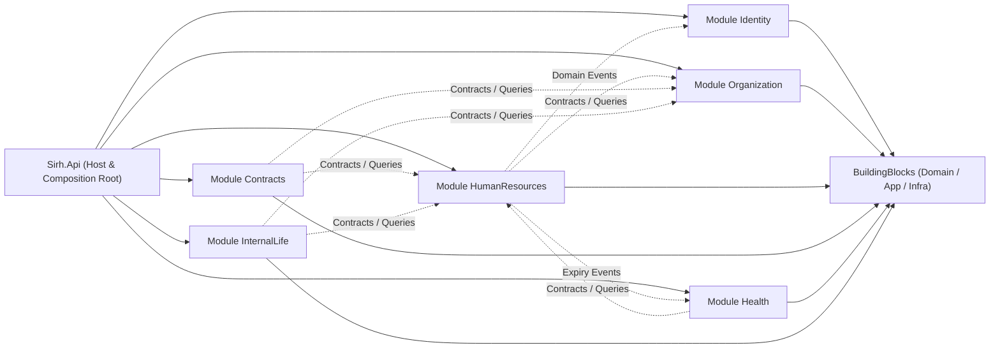

# Architecture Technique & Contrat d'API REST — SIRH (.NET 10)

> [!NOTE]
> Ce document décrit l'architecture cible du backend **SIRH** en **.NET 10** (**Monolithe Modulaire**), les décisions d'architecture (ADRs), le modèle de données **SQL Server** et le contrat d'API REST `/api/v1` agnostique du frontend.

---

## 1. Architecture Monolithe Modulaire .NET 10

### 1.1 Structure de la solution (`Sirh.sln`)
L'application est découpée en **modules métier autonomes** regroupés dans un seul exécutable ASP.NET Core (`Sirh.Api`), avec des briques transverses (`BuildingBlocks`) et une isolation stricte des dépendances entre modules :

```text
d:\repositories\sirh\
├── .gitignore                          # Exclut legacy-backend/, legacy-frontend/, bin/, obj/, storage/
├── docker-compose.yml                  # SQL Server 2022 + Mailpit (+ profil optionnel Azurite)
├── Sirh.slnx                           # Solution .NET 10
├── docs/                               # Spécifications, Architecture & Backlog Agile
├── src/
│   ├── Sirh.Api/                       # Hôte ASP.NET Core (Program.cs, Auth/RateLimit, OpenAPI/Scalar, Hangfire/BackgroundServices)
│   ├── BuildingBlocks/
│   │   ├── Sirh.BuildingBlocks.Domain/         # Entity, AuditableEntity, Result/Error, Guard, DomainEvent
│   │   ├── Sirh.BuildingBlocks.Application/    # ICurrentUser, PagedResult<T>, IEmailService, IFileStorageService, Validation
│   │   └── Sirh.BuildingBlocks.Infrastructure/ # AES-256-GCM, LocalEncryptedStorage, AzureBlobStorage, EF Audit Interceptor, MailKit
│   └── Modules/
│       ├── Identity/                   # Auth JWT + RefreshTokens, Identity, PasswordReset OTP, Roles & Permissions
│       ├── Organization/               # Companies, Locations, ContractTypes, Referentials
│       ├── HumanResources/             # Employees, EmergencyContacts, Positions, EmployeeDocuments (RQTH, ResidentPermit)
│       ├── Contracts/                  # ContractModels (Markdown/Scriban + QuestPDF), Contracts, JobSheets
│       ├── Health/                     # MedicalVisits, Notifications, Jobs planifiés (Visites + Expirations)
│       └── InternalLife/               # CommonDocuments, WelcomeKits, StaffRepresentatives, RseIdeas, OnboardingQuizzes
└── tests/
    ├── Sirh.ArchitectureTests/         # Règles d'isolation modulaire (NetArchTest.Rules)
    ├── Sirh.UnitTests/                 # Tests unitaires domaine & handlers (xUnit + NSubstitute + Shouldly)
    └── Sirh.IntegrationTests/          # Tests API bout-en-bout (WebApplicationFactory + Testcontainers.MsSql)
```

> [!TIP]
> **Organisation interne de chaque module** : chaque module suit un découpage **Clean Architecture + Vertical Slices** léger :
> - `Domain/` (Entités, Enums, Règles métier, Erreurs)
> - `Application/` (Use cases / Handlers par feature, DTOs, Validators FluentValidation, Ports/Interfaces)
> - `Infrastructure/` (DbContext dédié sur son schéma SQL, Configurations EF Core, Repositories)
> - `Presentation/` (Endpoints Minimal API groupés par ressource ou Controllers dédiés, filtres/policies)
> - `Contracts/` *(projet ou dossier public minimal)* : seuls les événements d'intégration et requêtes de lecture inter-modules exposées sont accessibles aux autres modules.

### 1.2 Graphe des dépendances & Communication inter-modules



- **Règle d'or** : aucun module n'accède directement au `DbContext` ou aux entités `Domain/Infrastructure` d'un autre module. Les interactions passent par des **interfaces de lecture publiques (`IEmployeeLookup`, `IOrganizationLookup`)** ou des **Domain/Integration Events in-process** (ex. `EmployeeDeactivatedEvent` révoquant les Refresh Tokens dans `Identity`, `DocumentExpiringEvent` créant une notification dans `Health`).

---

## 2. Architecture Decision Records (ADRs)

### ADR-01 — Monolithe Modulaire plutôt que Microservices
- **Décision** : Monolithe Modulaire ASP.NET Core déployé en un seul artefact, avec séparation stricte par modules et schémas SQL Server.
- **Justification** : Le domaine (~22 entités) gravite autour d'un noyau transactionnel unique (`Company` → `Employee` → `Position`). Les microservices introduiraient une latence réseau, une complexité de transactions distribuées et un coût DevOps injustifiés pour la taille du système, tout en gardant la possibilité d'extraire un module plus tard grâce à l'isolation des `DbContext`.

### ADR-02 — Authentification Locale (Identity + JWT court + Refresh Token rotatif)
- **Décision** : Utiliser **ASP.NET Core Identity** (hachage PBKDF2/Argon2, Lockout natif) combiné à :
  - **Access Token JWT** (HMAC-SHA256 ou RSA, durée **15 min**) contenant `sub` (`UserId`), `employeeId`, `email`, `roles`, `permissions` (ou résolution en cache/claims).
  - **Refresh Token opaque** (64 octets CSPRNG), persisté **hashé en SHA-256** en base (`identity.refresh_tokens`, durée **7 jours**), avec **rotation à chaque usage** et **détection de vol par famille de tokens**.
  - **Rate Limiting ASP.NET Core** natif (`FixedWindow` / `SlidingWindow`) sur `/api/v1/auth/login`, `/refresh`, `/password/forgot`, `/password/reset`.
- **Justification** : Corrige les sessions de 5 h non révocables sur redémarrage (`TokenSaver` en mémoire) tout en restant 100 % autonome sans fournisseur externe (Keycloak/Entra ID).

### ADR-03 — Autorisation Hybride RBAC (Permissions) + ABAC (`IAuthorizationHandler`)
- **Décision** :
  - Remplacer `AccessLevel` (couplé aux URLs React CoreUI) par un catalogue de **Permissions métier** associées aux rôles.
  - Implémenter des `AuthorizationRequirement` / `IAuthorizationHandler` pour les contrôles **ABAC** (ex. `CanAccessEmployeeResourceRequirement` vérifiant `Self`, `DirectReportManager`, ou permission `*:all`).
- **Justification** : Élimine toutes les failles IDOR identifiées dans l'audit et rend l'API indépendante du framework frontend (React, Angular, mobile).

### ADR-04 — Génération PDF native 100 % .NET (Scriban + QuestPDF)
- **Décision** : Remplacer LibreOffice + `.docx` par des modèles texte en **Markdown + syntaxe Scriban** rendus en PDF côté serveur avec **QuestPDF**.
- **Justification** : Zéro dépendance binaire externe (fini LibreOffice / `LIBREOFFICE_PATH`), génération rapide (< 50 ms), typage fort des variables de modèle, versionnement/diff facile du contenu des modèles en base.
- **Note de licence** : *QuestPDF* utilise la **QuestPDF Community License** (gratuite et libre d'usage commercial pour les entreprises dont le chiffre d'affaires annuel brut est inférieur à 1 M USD ; licence commerciale payante au-delà). Si ce seuil devait être dépassé ou qu'une licence 100 % MIT était exigée, le moteur de rendu PDF est encapsulé derrière `IPdfContractGenerator` et substituable par **PDFsharp / MigraDoc** (MIT).

### ADR-05 — Abstraction de Stockage Chiffré (`IFileStorageService`) vers Azure Blob Storage
- **Décision** : Définir `IFileStorageService` avec support de deux modes (`Encrypted` pour les données collaborateurs/RSE, `Standard` pour les documents communs) :
  - **Implémentation Phase 1 (Locale)** : `LocalFileStorageService` sur disque + chiffrement **AES-256-GCM** (clé dédiée `Encryption:MasterKey` de 32 octets, **séparée** de `Jwt:SigningKey`, IV aléatoire 12 octets + tag 16 octets).
  - **Implémentation Phase 2 (Cloud Azure)** : `AzureBlobFileStorageService` basé sur `Azure.Storage.Blobs` (compatible **Azurite** en local Docker, puis **Managed Identity** sur Azure), activable par simple configuration (`Storage:Provider = "AzureBlob"`).
- **Justification** : Répond au besoin immédiat de stockage local chiffré tout en offrant une rampe d'apprentissage directe vers Azure Blob Storage sans réécrire la logique métier.

### ADR-06 — Persistance SQL Server & EF Core 10
- **Décision** : SQL Server avec **1 `DbContext` par module**, isolé dans son propre schéma SQL (`identity`, `org`, `hr`, `contracts`, `health`, `internal_life`), clés primaires `Guid` séquentiels (`Guid.CreateVersion7()` en .NET 10), vraies clés étrangères SQL intra-module, `byte[] RowVersion` (`IsRowVersion()`) pour la concurrence optimiste, et `SaveChangesInterceptor` pour l'audit automatique (`CreatedAtUtc`, `CreatedBy`, `UpdatedAtUtc`, `UpdatedBy`).
- **Justification** : Élimine les FK manquantes sur des `slug` texte, évite l'index fragmentation SQL Server sur `Guid` grâce au UUIDv7, et garantit l'isolation des modules.

### ADR-07 — Contrat API REST v1 & Standards
- **Décision** : Préfixe `/api/v1/...`, noms de ressources au pluriel en kebab-case sans verbes dans les URLs (sauf actions métier explicites comme `/activate`, `/preview`, `/submit`, `/read-all`), réponses d'erreur normalisées **RFC 9457 `ProblemDetails`**, pagination uniforme `PagedResult<T>`, **flux binaires purs** (`FileStreamResult` / `Results.File`) sur `/.../file` (aucun `byte[]` base64 embarqué dans les DTOs JSON), et documentation OpenAPI 3.1 + **Scalar**.

---

## 3. Modèle de données cible (SQL Server)

```mermaid
erDiagram
    COMPANY {
        uniqueidentifier Id PK
        string Name UK
        string Siret
        string CollectiveAgreement
        bool IsActive
    }
    LOCATION {
        uniqueidentifier Id PK
        string Slug UK
        string Name
        string City
        bool IsPublished
        uniqueidentifier CompanyId FK
    }
    CONTRACT_TYPE {
        uniqueidentifier Id PK
        string Code UK
        string Label
        bool IsSystem
    }
    APP_USER {
        uniqueidentifier Id PK
        string Email UK
        bool IsActive
    }
    ROLE {
        uniqueidentifier Id PK
        string Code UK
        int Priority
    }
    PERMISSION {
        uniqueidentifier Id PK
        string Code UK
    }
    REFRESH_TOKEN {
        uniqueidentifier Id PK
        uniqueidentifier UserId FK
        string TokenHash UK
        string FamilyId
        datetime2 ExpiresAtUtc
        datetime2 RevokedAtUtc
    }
    EMPLOYEE {
        uniqueidentifier Id PK
        uniqueidentifier UserId FK
        uniqueidentifier CompanyId FK
        string Slug UK
        string Email UK
        string FirstName
        string LastName
        string NationalIdEncrypted
        bool IsActive
    }
    EMERGENCY_CONTACT {
        uniqueidentifier Id PK
        uniqueidentifier EmployeeId FK
        string FullNameEncrypted
        string RelationshipEncrypted
        string MobilePhoneEncrypted
        int PriorityOrder
    }
    POSITION {
        uniqueidentifier Id PK
        string Slug UK
        uniqueidentifier EmployeeId FK
        uniqueidentifier ManagerId FK
        uniqueidentifier LocationId FK
        string JobTitle
        date StartAt
        date EndAt
    }
    CONTRACT_MODEL {
        uniqueidentifier Id PK
        string Title UK
        uniqueidentifier ContractTypeId FK
        string TemplateMarkdown
        bool IsActive
    }
    CONTRACT {
        uniqueidentifier Id PK
        uniqueidentifier PositionId UK
        uniqueidentifier EmployeeId FK
        uniqueidentifier ContractTypeId FK
        uniqueidentifier ContractModelId FK
        string Status
        string FileKey
    }
    JOB_SHEET {
        uniqueidentifier Id PK
        uniqueidentifier PositionId UK
        uniqueidentifier EmployeeId FK
        string FileKey
    }
    EMPLOYEE_DOCUMENT {
        uniqueidentifier Id PK
        uniqueidentifier EmployeeId FK
        string Category
        string DocumentType
        string FileKey
        date FileDate
    }
    RQTH_DETAIL {
        uniqueidentifier DocumentId PK
        date ExpiryDate
        string AccommodationNote
    }
    RESIDENT_PERMIT_DETAIL {
        uniqueidentifier DocumentId PK
        string PermitNumber
        date ExpiryDate
    }
    MEDICAL_VISIT {
        uniqueidentifier Id PK
        uniqueidentifier EmployeeId FK
        string VisitType
        datetime2 VisitDateTimeUtc
        date ValidityDate
        bool CarriedOut
        string ConvocationFileKey
        string ReportFileKey
        datetime2 ReminderSentAtUtc
    }
    NOTIFICATION {
        uniqueidentifier Id PK
        uniqueidentifier RecipientEmployeeId FK
        string Category
        string Subject
        bool IsRead
        datetime2 CreatedAtUtc
    }
    COMMON_DOCUMENT {
        uniqueidentifier Id PK
        uniqueidentifier CompanyId FK
        uniqueidentifier ContractTypeId FK
        string Category
        bool IsWelcomeKit
        bool IsArchived
        string FileKey
    }
    STAFF_REPRESENTATIVE {
        uniqueidentifier Id PK
        uniqueidentifier CompanyId FK
        uniqueidentifier EmployeeId FK
        string RepresentativeRole
        bool IsHarassmentAdvisor
    }
    RSE_IDEA {
        uniqueidentifier Id PK
        uniqueidentifier AuthorEmployeeId FK
        uniqueidentifier LocationId FK
        string Status
        string AttachmentFileKey
    }
    ONBOARDING_QUIZ {
        uniqueidentifier Id PK
        uniqueidentifier CompanyId FK
        string Title
        int PassingScorePercent
        bool IsPublished
    }
    QUIZ_QUESTION {
        uniqueidentifier Id PK
        uniqueidentifier QuizId FK
        string QuestionType
        int OrderIndex
    }
    QUIZ_CHOICE {
        uniqueidentifier Id PK
        uniqueidentifier QuestionId FK
        string ChoiceText
        bool IsCorrect
    }
    QUIZ_ATTEMPT {
        uniqueidentifier Id PK
        uniqueidentifier QuizId FK
        uniqueidentifier EmployeeId FK
        int ScorePercent
        bool Passed
    }

    COMPANY ||--o{ LOCATION : "heberge"
    COMPANY ||--o{ EMPLOYEE : "emploie"
    APP_USER ||--o| EMPLOYEE : "authentifie"
    APP_USER ||--o{ REFRESH_TOKEN : "detient"
    ROLE }o--o{ PERMISSION : "accorde"
    EMPLOYEE ||--o{ EMERGENCY_CONTACT : "declare"
    EMPLOYEE ||--o{ POSITION : "occupe"
    EMPLOYEE ||--o{ POSITION : "manage"
    LOCATION ||--o{ POSITION : "situe"
    CONTRACT_TYPE ||--o{ CONTRACT_MODEL : "classe"
    CONTRACT_TYPE ||--o{ CONTRACT : "type"
    POSITION ||--o| CONTRACT : "formalise"
    POSITION ||--o| JOB_SHEET : "decrit"
    EMPLOYEE ||--o{ EMPLOYEE_DOCUMENT : "possede"
    EMPLOYEE_DOCUMENT ||--o| RQTH_DETAIL : "detaille"
    EMPLOYEE_DOCUMENT ||--o| RESIDENT_PERMIT_DETAIL : "detaille"
    EMPLOYEE ||--o{ MEDICAL_VISIT : "passe"
    EMPLOYEE ||--o{ NOTIFICATION : "recoit"
    COMPANY ||--o{ COMMON_DOCUMENT : "diffuse"
    CONTRACT_TYPE ||--o{ COMMON_DOCUMENT : "cible"
    COMPANY ||--o{ STAFF_REPRESENTATIVE : "elit"
    EMPLOYEE ||--o{ RSE_IDEA : "propose"
    LOCATION ||--o{ RSE_IDEA : "concerne"
    ONBOARDING_QUIZ ||--o{ QUIZ_QUESTION : "contient"
    QUIZ_QUESTION ||--o{ QUIZ_CHOICE : "propose"
    ONBOARDING_QUIZ ||--o{ QUIZ_ATTEMPT : "evalue"
    EMPLOYEE ||--o{ QUIZ_ATTEMPT : "passe"
```



---

## 4. Contrat d'API REST cible (`/api/v1`)

### 4.1 Conventions transverses
- **Base URL** : `/api/v1`
- **Pagination** : `?page=1&pageSize=20` (`page` 1-based, `pageSize` 1..100). Réponse :
  ```json
  {
    "items": [],
    "page": 1,
    "pageSize": 20,
    "totalCount": 42,
    "totalPages": 3
  }
  ```
- **Concurrence optimiste** : `RowVersion` (Base64 string) dans les payloads `PUT`/`PATCH` ; `409 Conflict` (`ProblemDetails`) en cas de modification concurrente.
- **Erreurs** : `application/problem+json` (RFC 9457) avec `type`, `title`, `status`, `detail`, `traceId` et dictionnaire `errors` pour les erreurs de validation (`400`/`422`).
- **Téléchargement de fichiers** : toujours via `GET .../file` retournant le stream binaire déchiffré avec `Content-Type` et `Content-Disposition: inline; filename="..."` (ou `attachment` via `?download=true`).

### 4.2 Endpoints par module

#### Module `System` & `Identity` (`/api/v1/auth`, `/api/v1/roles`)
| Méthode | Route | Description | Auth / Policy | Codes HTTP |
|---|---|---|---|---|
| `GET` | `/health` | Healthcheck ASP.NET Core (API + SQL Server + Storage) | Public | 200, 503 |
| `POST` | `/api/v1/auth/login` | Authentification email + password → Access JWT + Refresh Token | Public + RateLimit | 200, 401, 423, 429 |
| `POST` | `/api/v1/auth/refresh` | Rotation du Refresh Token → nouveau couple Access/Refresh | Public + RateLimit | 200, 401, 429 |
| `POST` | `/api/v1/auth/logout` | Révoque le Refresh Token fourni | Authentifié | 204, 401 |
| `POST` | `/api/v1/auth/logout-all` | Révoque toutes les sessions actives de l'utilisateur | Authentifié | 204, 401 |
| `GET` | `/api/v1/auth/me` | Profil connecté, rôles, permissions, poste actif, non-lues | Authentifié | 200, 401 |
| `POST` | `/api/v1/auth/password/change` | Change le mot de passe (mot de passe actuel requis) | Authentifié | 204, 400, 401 |
| `POST` | `/api/v1/auth/password/forgot` | Génère/envoie OTP 6 chiffres (réponse générique) | Public + RateLimit | 202, 429 |
| `POST` | `/api/v1/auth/password/reset` | Réinitialise le mot de passe avec OTP 6 chiffres | Public + RateLimit | 204, 400, 429 |
| `GET` | `/api/v1/roles` | Liste des rôles | `roles:read` | 200 |
| `GET` | `/api/v1/permissions` | Catalogue de toutes les permissions métier | `roles:read` | 200 |
| `GET` | `/api/v1/roles/{id}/permissions` | Permissions affectées à un rôle | `roles:read` | 200, 404 |
| `PUT` | `/api/v1/roles/{id}/permissions` | Remplace les permissions d'un rôle | `roles:manage-permissions` | 200, 403, 404 |

#### Module `Organization` (`/api/v1/companies`, `/locations`, `/contract-types`, `/referentials`)
| Méthode | Route | Description | Auth / Policy | Codes HTTP |
|---|---|---|---|---|
| `GET` | `/api/v1/companies` | Liste paginée + filtres (`active`, `search`) | `companies:read` | 200 |
| `GET` | `/api/v1/companies/{id}` | Détail d'une entreprise | `companies:read` | 200, 404 |
| `POST` | `/api/v1/companies` | Crée une entreprise | `companies:write` | 201, 400, 409 |
| `PUT` | `/api/v1/companies/{id}` | Met à jour une entreprise | `companies:write` | 200, 400, 404, 409 |
| `PATCH` | `/api/v1/companies/{id}/status` | Active/désactive une entreprise | `companies:write` | 200, 404 |
| `GET` | `/api/v1/locations` | Liste paginée + filtres (`published`, `companyId`, `search`) | `locations:read` | 200 |
| `GET` | `/api/v1/locations/{id}` | Détail d'un lieu | `locations:read` | 200, 404 |
| `POST` | `/api/v1/locations` | Crée un lieu | `locations:write` | 201, 400, 409 |
| `PUT` | `/api/v1/locations/{id}` | Met à jour un lieu | `locations:write` | 200, 400, 404, 409 |
| `DELETE` | `/api/v1/locations/{id}` | Supprime un lieu (si non référencé) | `locations:write` | 204, 404, 409 |
| `GET` | `/api/v1/contract-types` | Liste paginée + filtre `search`, `active` | `contract-types:read` | 200 |
| `POST` | `/api/v1/contract-types` | Crée un type de contrat | `contract-types:write` | 201, 400, 409 |
| `PUT` | `/api/v1/contract-types/{id}` | Met à jour un type de contrat | `contract-types:write` | 200, 400, 403, 404, 409 |
| `DELETE` | `/api/v1/contract-types/{id}` | Supprime un type de contrat (`IsSystem=false` et non utilisé) | `contract-types:write` | 204, 403, 404, 409 |
| `GET` | `/api/v1/referentials/departments` | Liste des départements métier (`code`, `label`) | Authentifié | 200 |

#### Module `HumanResources` (`/api/v1/employees`, `/positions`, `/emergency-contacts`, `/employee-documents`)
| Méthode | Route | Description | Auth / Policy | Codes HTTP |
|---|---|---|---|---|
| `GET` | `/api/v1/employees` | Liste paginée filtrable (`companyId`, `job`, `managerId`, `department`, `active`, `inPosition`, `role`, `search`) | `employees:read:team` ou `:all` (périmètre filtré par ABAC) | 200 |
| `GET` | `/api/v1/employees/{id}` | Fiche détaillée (projection adaptée selon `Self`/`Manager`/`HR`) | ABAC `EmployeeRead` | 200, 403, 404 |
| `POST` | `/api/v1/employees` | Crée un collaborateur + compte + rôles + email pro auto | `employees:write` (+ check `manage-privileged`) | 201, 400, 403, 409 |
| `PUT` | `/api/v1/employees/{id}` | Met à jour fiche + rôles (vérification `RowVersion`) | `employees:write` (+ anti-escalade) | 200, 400, 403, 404, 409 |
| `POST` | `/api/v1/employees/{id}/deactivate` | Désactive le collaborateur + révoque ses sessions | `employees:write` (+ anti-escalade) | 204, 403, 404 |
| `POST` | `/api/v1/employees/{id}/activate` | Réactive le collaborateur | `employees:write` (+ anti-escalade) | 204, 403, 404 |
| `GET` | `/api/v1/employees/{employeeId}/emergency-contacts` | Liste des contacts d'urgence déchiffrés du salarié | ABAC `Self` ou `HR`+ | 200, 403, 404 |
| `POST` | `/api/v1/employees/{employeeId}/emergency-contacts` | Ajoute un contact d'urgence (max 2) | ABAC `Self` ou `HR`+ | 201, 400, 403, 422 |
| `PUT` | `/api/v1/emergency-contacts/{id}` | Met à jour un contact d'urgence | ABAC `Self` ou `HR`+ | 200, 400, 403, 404, 409 |
| `DELETE` | `/api/v1/emergency-contacts/{id}` | Supprime un contact d'urgence | ABAC `Self` ou `HR`+ | 204, 403, 404 |
| `GET` | `/api/v1/employees/{employeeId}/positions` | Historique des postes d'un collaborateur | ABAC `EmployeeRead` | 200, 403, 404 |
| `POST` | `/api/v1/positions` | Crée un poste | `positions:write` | 201, 400, 404 |
| `PUT` | `/api/v1/positions/{id}` | Met à jour un poste | `positions:write` | 200, 400, 404, 409 |
| `DELETE` | `/api/v1/positions/{id}` | Supprime un poste (si sans contrat ni fiche de poste) | `positions:write` | 204, 404, 409 |
| `GET` | `/api/v1/employee-documents` | Liste paginée filtrable (`employeeId`, `category`, `documentTypes`, `search`) | ABAC (`Self`/`Team`/`All` + masquage `Sensitive`) | 200, 403 |
| `GET` | `/api/v1/employee-documents/{id}` | Métadonnées (+ détails RQTH / Titre séjour le cas échéant) | ABAC `EmployeeDocumentRead` | 200, 403, 404 |
| `GET` | `/api/v1/employee-documents/{id}/file` | Télécharge le document déchiffré | ABAC `EmployeeDocumentRead` | 200, 403, 404 |
| `POST` | `/api/v1/employee-documents` | Upload multipart chiffré (+ champs RQTH / Titre séjour) | ABAC `EmployeeDocumentWrite` | 201, 400, 403 |
| `PUT` | `/api/v1/employee-documents/{id}` | Met à jour métadonnées et/ou remplace fichier | ABAC `EmployeeDocumentWrite` | 200, 400, 403, 404, 409 |
| `DELETE` | `/api/v1/employee-documents/{id}` | Supprime document + fichier chiffré | `employee-docs:write:all` (ou propriétaire si autorisé) | 204, 403, 404 |

#### Module `Contracts` (`/api/v1/contract-models`, `/contracts`, `/job-sheets`)
| Méthode | Route | Description | Auth / Policy | Codes HTTP |
|---|---|---|---|---|
| `GET` | `/api/v1/contract-models` | Liste paginée des modèles Markdown/Scriban | `contract-models:read` | 200 |
| `GET` | `/api/v1/contract-models/variables` | Catalogue des variables Scriban disponibles | `contract-models:read` | 200 |
| `GET` | `/api/v1/contract-models/{id}` | Détail complet du modèle | `contract-models:read` | 200, 404 |
| `POST` | `/api/v1/contract-models` | Crée un modèle | `contract-models:write` | 201, 400, 409 |
| `PUT` | `/api/v1/contract-models/{id}` | Met à jour un modèle | `contract-models:write` | 200, 400, 404, 409 |
| `DELETE` | `/api/v1/contract-models/{id}` | Supprime un modèle | `contract-models:write` | 204, 404 |
| `POST` | `/api/v1/contract-models/{id}/preview` | Rendu PDF temps réel (QuestPDF) sans persistence | `contract-models:read` / `contracts:write` | 200 (PDF), 400, 404 |
| `GET` | `/api/v1/contracts` | Liste paginée filtrable (`employeeId`, `contractTypeId`, `status`, `search`) | `contracts:read:all` (ou filtré `Self`) | 200 |
| `GET` | `/api/v1/contracts/by-position/{positionId}` | Contrat d'un poste | ABAC `ContractRead` | 200, 403, 404 |
| `GET` | `/api/v1/contracts/{id}/file` | Télécharge le PDF du contrat déchiffré | ABAC `ContractRead` | 200 (PDF), 403, 404 |
| `POST` | `/api/v1/contracts/generate` | Génère le contrat PDF depuis un modèle et l'enregistre | `contracts:write` | 201, 400, 404, 409 |
| `POST` | `/api/v1/contracts` | Importe un contrat PDF existant (multipart) | `contracts:write` | 201, 400, 409 |
| `PUT` | `/api/v1/contracts/{id}` | Met à jour statut (`Signed`, `SignedAt`), type ou remplace PDF | `contracts:write` | 200, 400, 404, 409 |
| `DELETE` | `/api/v1/contracts/{id}` | Supprime le contrat + fichier | `contracts:write` | 204, 404 |
| `GET` | `/api/v1/job-sheets/by-position/{positionId}` | Métadonnées fiche de poste d'un poste | ABAC `JobSheetRead` | 200, 403, 404 |
| `GET` | `/api/v1/job-sheets/{id}/file` | Télécharge le PDF de la fiche de poste | ABAC `JobSheetRead` | 200 (PDF), 403, 404 |
| `POST` | `/api/v1/job-sheets` | Crée une fiche de poste (multipart) | `jobsheets:write` | 201, 400, 409 |
| `PUT` | `/api/v1/job-sheets/{id}` | Met à jour / remplace le PDF | `jobsheets:write` | 200, 400, 404, 409 |
| `DELETE` | `/api/v1/job-sheets/{id}` | Supprime la fiche de poste + fichier | `jobsheets:write` | 204, 404 |

#### Module `Health` (`/api/v1/medical-visits`, `/notifications`)
| Méthode | Route | Description | Auth / Policy | Codes HTTP |
|---|---|---|---|---|
| `GET` | `/api/v1/medical-visits` | Liste paginée filtrable (`employeeId`, `visitType`, `fromDate`, `toDate`, `carriedOut`) | `medical-visits:read:all` ou filtré `Self` | 200 |
| `GET` | `/api/v1/medical-visits/{id}` | Détail d'une visite | ABAC `MedicalVisitRead` | 200, 403, 404 |
| `GET` | `/api/v1/medical-visits/{id}/convocation-file` | Télécharge convocation déchiffrée | ABAC `MedicalVisitRead` | 200, 403, 404 |
| `GET` | `/api/v1/medical-visits/{id}/report-file` | Télécharge rapport déchiffré | ABAC `MedicalVisitRead` | 200, 403, 404 |
| `POST` | `/api/v1/medical-visits` | Crée une visite (convocation obligatoire, multipart) | `medical-visits:write` | 201, 400 |
| `PUT` | `/api/v1/medical-visits/{id}` | Met à jour visite / convocation / rapport | `medical-visits:write` | 200, 400, 404, 409 |
| `DELETE` | `/api/v1/medical-visits/{id}` | Supprime visite + fichiers | `medical-visits:write` | 204, 404 |
| `GET` | `/api/v1/notifications` | Liste paginée des notifications de l'utilisateur connecté | `notifications:read:self` | 200 |
| `GET` | `/api/v1/notifications/unread-count` | Nombre de notifications non lues | `notifications:read:self` | 200 |
| `PATCH` | `/api/v1/notifications/{id}/read` | Marque une notification comme lue | ABAC `Self` | 204, 403, 404 |
| `POST` | `/api/v1/notifications/read-all` | Marque toutes ses notifications comme lues | `notifications:write:self` | 204 |
| `DELETE` | `/api/v1/notifications/{id}` | Supprime une de ses notifications | ABAC `Self` | 204, 403, 404 |

#### Module `InternalLife` (`/api/v1/common-documents`, `/staff-representatives`, `/rse-ideas`, `/onboarding-quizzes`)
| Méthode | Route | Description | Auth / Policy | Codes HTTP |
|---|---|---|---|---|
| `GET` | `/api/v1/common-documents` | Liste paginée (`companyId`, `category`, `isWelcomeKit`, `contractTypeId`, `archived`, `search`) | `common-docs:read` | 200 |
| `GET` | `/api/v1/common-documents/{id}/file` | Télécharge le document commun | `common-docs:read` | 200, 404 |
| `POST` | `/api/v1/common-documents` | Upload document commun ou kit d'accueil (multipart) | `common-docs:write` (ou `:cse` si catégorie CSE) | 201, 400, 403 |
| `PUT` | `/api/v1/common-documents/{id}` | Met à jour métadonnées / fichier | `common-docs:write` (ou `:cse`) | 200, 400, 403, 404, 409 |
| `PATCH` | `/api/v1/common-documents/{id}/archive` | Archive / désarchive un document | `common-docs:write` (ou `:cse`) | 204, 403, 404 |
| `DELETE` | `/api/v1/common-documents/{id}` | Supprime un document commun | `common-docs:write` (ou `:cse`) | 204, 403, 404 |
| `GET` | `/api/v1/staff-representatives` | Liste paginée (`companyId`, `role`, `harassmentAdvisor`, `search`) | `staff-reps:read` | 200 |
| `POST` | `/api/v1/staff-representatives` | Ajoute un représentant | `staff-reps:write` | 201, 400, 409 |
| `PUT` | `/api/v1/staff-representatives/{id}` | Met à jour un représentant | `staff-reps:write` | 200, 400, 404, 409 |
| `DELETE` | `/api/v1/staff-representatives/{id}` | Supprime un représentant | `staff-reps:write` | 204, 404 |
| `GET` | `/api/v1/rse-ideas` | Liste paginée (`locationId`, `status`, `mineOnly`) | `rse:read:all` ou `rse:read:self` (filtré) | 200 |
| `GET` | `/api/v1/rse-ideas/{id}` & `/{id}/file` | Détail / téléchargement PJ chiffrée | ABAC `Author` ou `rse:read:all` | 200, 403, 404 |
| `POST` | `/api/v1/rse-ideas` | Soumet une idée RSE (multipart, PJ optionnelle) | `rse:write` | 201, 400 |
| `PUT` | `/api/v1/rse-ideas/{id}` | Modifie son idée (si `Status == Submitted`) | ABAC `Author` | 200, 400, 403, 404, 409 |
| `PATCH` | `/api/v1/rse-ideas/{id}/status` | Met à jour statut (`InReview`, `Treated`, `Rejected`) + commentaire RH | `rse:treat` | 200, 400, 403, 404 |
| `DELETE` | `/api/v1/rse-ideas/{id}` | Supprime son idée (`Submitted`) ou suppression RH | ABAC `Author` (si `Submitted`) ou `rse:treat` | 204, 403, 404 |
| `GET` | `/api/v1/onboarding-quizzes` | Liste paginée des QCM (publiés pour salarié, tous pour RH) | `quizzes:read` | 200 |
| `GET` | `/api/v1/onboarding-quizzes/{id}` | Détail QCM (avec bonnes réponses si `quizzes:write`, sans sinon) | `quizzes:read` / `quizzes:write` | 200, 404 |
| `POST` | `/api/v1/onboarding-quizzes` | Crée un QCM + questions + choix | `quizzes:write` | 201, 400 |
| `PUT` | `/api/v1/onboarding-quizzes/{id}` | Met à jour QCM + questions + choix | `quizzes:write` | 200, 400, 404, 409 |
| `PATCH` | `/api/v1/onboarding-quizzes/{id}/publish` | Publie / dépublie un QCM | `quizzes:write` | 200, 400, 404 |
| `POST` | `/api/v1/onboarding-quizzes/{id}/attempts` | Démarre un passage QCM | `quizzes:take` | 201, 400, 404 |
| `POST` | `/api/v1/onboarding-quizzes/attempts/{attemptId}/submit` | Soumet réponses, calcule score & retourne correction | ABAC `AttemptOwner` | 200, 400, 403, 404, 409 |
| `GET` | `/api/v1/onboarding-quizzes/{id}/attempts` | Historique & scores des passages (tous pour RH, les siens sinon) | `quizzes:results:all` ou `Self` | 200, 404 |

---

## 5. Stratégie Qualité, Tests & Environnement Local

1. **Tests Unitaires (`Sirh.UnitTests`)** : logique domaine pure (génération d'email, calcul de poste courant, validation des transitions RSE, scoring QCM, règles anti-escalade, chiffrement AES-256-GCM).
2. **Tests d'Architecture (`Sirh.ArchitectureTests`)** : vérification automatisée avec `NetArchTest.Rules` qu'aucun module n'importe le `Domain`, `Application` interne ou `Infrastructure` d'un autre module.
3. **Tests d'Intégration (`Sirh.IntegrationTests`)** : `WebApplicationFactory<Program>` + **Testcontainers (`MsSqlContainer`)** testant les endpoints HTTP réels, les migrations EF Core, les statuts `ProblemDetails`, et les scénarios **anti-IDOR (403)** sur un vrai SQL Server.
4. **Environnement local (`docker-compose.yml`)** :
   - `sqlserver` (SQL Server 2022 Developer) — ou SQL Server LocalDB en alternative Windows légère.
   - `mailpit` (capture SMTP locale avec interface web sur `:8025` pour inspecter les codes OTP et rappels médicaux).
   - `azurite` (sous profil Docker `--profile azure` pour tester le driver Azure Blob localement).
